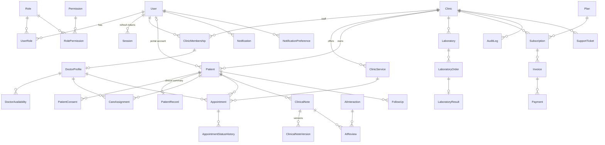

# AfyaLink AI — Phase 1: Assessment & Architecture Plan

Status: approved baseline for MVP build · Last updated: 2026-11-21

## 1. Repository assessment

| Item | Finding |
|---|---|
| Repository | `beri12/AfiyaAfrica`, branch `claude/eloquent-tesla-ce18ou` |
| Existing code | None — empty repository, no commits |
| Existing tooling/config | None to preserve |
| Build environment | Node 22, pnpm 10, PostgreSQL 16, Redis 7, Docker 29 available |

Consequences: greenfield monorepo, no migration constraints. We pin **stable, well-understood major versions**
rather than the newest majors (Next 15, React 19, NestJS 11, Prisma 6, Zod 3, TypeScript 5.9, Tailwind 4,
Jest 29, ESLint 9) to reduce pilot risk. Upgrades are a post-pilot task.

## 2. Architecture

```
                ┌─────────────── Nginx (TLS, CSP, rate limit, gzip) ───────────────┐
 Browser ──────►│  /            → web (Next.js 15, App Router, SSR + client)       │
                │  /api/v1/*    → api (NestJS 11, REST, Swagger at /api/docs)      │
                └──────────────────────────────────────────────────────────────────┘
                                         │
               ┌──────────────┬──────────┴───────┬───────────────────┐
           PostgreSQL 16   Redis 7 (BullMQ     AI provider        SMS / Email
           (Prisma ORM)    queues, rate limit) (OpenAI-compatible, providers
                                                optional, redacted) (optional)
```

**Monorepo (pnpm workspaces)**

```
apps/web          Next.js frontend (public site, clinic app, doctor workspace, patient portal, platform admin)
apps/api          NestJS REST API (+ BullMQ workers in-process, toggle via WORKERS_ENABLED)
packages/shared   Zod schemas, enums, permission matrix, API contracts (single source of truth)
packages/config   Shared tsconfig / eslint presets
infrastructure/   docker/, nginx/, backup scripts
docs/             Architecture, API, security, privacy, PRD, deployment
scripts/          Dev / ops scripts
.github/workflows CI
```

**Key decisions**

1. **Validation once, used twice.** Zod schemas in `packages/shared` validate on the server (Nest pipe) and drive
   React Hook Form on the client. Swagger schemas are generated from the same Zod schemas.
2. **Authentication.** Short-lived JWT access token (15 min, held in memory by the SPA) + opaque refresh token
   (256-bit random, stored SHA-256 hashed, httpOnly/Secure/SameSite=Strict cookie scoped to `/api/v1/auth`).
   Refresh tokens rotate on every use; **reuse of a rotated token revokes the whole token family**.
   Passwords hashed with **Argon2id**. Optional TOTP MFA (secret encrypted AES-256-GCM).
3. **Tenancy.** Each clinic is a tenant. Every clinic-owned row carries `clinicId`. The client sends
   `X-Clinic-Id`; `TenantGuard` re-validates the caller's **active membership in the DB on every request** and
   attaches `{clinicId, role}` to the request. Services take `clinicId` from that context only — never from the
   body — and every query filters on it (`TenantScopedRepository` helpers + isolation tests).
4. **Authorization.** Code-defined role → permission matrix (in `shared`), enforced by `PermissionsGuard` on every
   endpoint via `@RequirePermissions()`. A global guard denies any route lacking an explicit `@Public()` or
   permission declaration (secure-by-default). Role/Permission tables are seeded from the matrix for reporting.
   Clinical data has an additional **care-relationship check** (doctor must be assigned to the patient).
5. **Appointment integrity.** A PostgreSQL **exclusion constraint** (`btree_gist`, `tstzrange`) prevents
   overlapping active bookings per doctor even under concurrent requests; service layer pre-checks for friendly
   errors. All times stored UTC (`timestamptz`); clinic timezone (default `Africa/Addis_Ababa`) used for
   availability windows and display.
6. **Clinical notes.** Immutable `ClinicalNoteVersion` rows; note status DRAFT → IN_REVIEW → SIGNED → AMENDED.
   Signed content is never edited — amendments create new versions. Note bodies encrypted at rest (AES-256-GCM).
7. **AI.** Provider-agnostic `AiProvider` interface; OpenAI-compatible HTTP adapter enabled only when configured
   (otherwise endpoints return `503 AI_NOT_CONFIGURED` — no fake output). Safety pipeline: emergency detection
   (EN/AM) → PII redaction → grounded prompt → output validation (diagnosis/prescription blocking, schema check)
   → labeling. Drafts require clinician review (`AIReview`). Logs keep model/version/latency/flags and a prompt
   hash, **not** raw prompts.
8. **Background jobs.** BullMQ queues: `notifications` (delivery), `reminders` (delayed, re-validated on run),
   `maintenance` (retention purges, invoice generation).
9. **Audit.** Append-only `AuditLog` (DB trigger blocks UPDATE/DELETE); metadata never contains clinical content.
   Patient record and note reads are logged (record access history).

## 3. Database ERD (core)



Full field-level schema: `apps/api/prisma/schema.prisma` (UUID PKs, `createdAt/updatedAt`, indexes on
`clinicId` + query columns, soft delete on Patient/User/ClinicService/Membership, uniqueness e.g.
`(clinicId, medicalRecordNumber)`).

**Data minimization:** no national ID, religion, ethnicity or income. Emergency contact optional.
Clinical summary (`PatientRecord`) separated from demographic `Patient` so the receptionist role can be given
demographics without clinical access.

## 4. API module plan (`/api/v1`)

| Module | Key endpoints | Main permissions |
|---|---|---|
| Health | `GET /health`, `GET /health/ready` | public |
| Auth | `POST /auth/login`, `/auth/refresh`, `/auth/logout`, `/auth/activate`, `/auth/mfa/*`, `GET /auth/me` | public / authenticated |
| Clinics/Tenants | `POST /clinics/register` (public), `GET/PATCH /clinic`, platform: `GET /platform/clinics`, `POST /platform/clinics/:id/approve` | `clinic:*`, `platform:*` |
| Users (staff) | `GET/POST /staff`, `PATCH /staff/:id`, invitations | `staff:*` |
| Doctors | `GET /doctors`, `PUT /doctors/:id/availability`, `GET /doctors/:id/slots` | `staff:read`, `appointment:*` |
| Services | CRUD `/services` | `service:*` |
| Patients | CRUD `/patients`, search, `/patients/:id/access-log`, `/patients/:id/invite` | `patient:*` |
| Consent | `GET/POST /patients/:id/consents`, `/me/consents` | `consent:*` |
| Appointments | CRUD, `/appointments/:id/{confirm,cancel,reschedule,complete,no-show}` | `appointment:*` |
| ClinicalRecords | notes CRUD, `/notes/:id/{submit,sign,amend}`, versions, patient record summary | `clinical:*` + care check |
| FollowUps | CRUD `/follow-ups` | `followup:*` |
| AI | `POST /ai/assistant`, `/ai/clinical-draft`, `/ai/health-info`, `POST /ai/reviews`, content approval | `ai:*` |
| Notifications | `GET /notifications`, mark read, preferences | authenticated |
| Analytics | `GET /analytics/overview`, `/analytics/appointments`, `/analytics/patients`, `/analytics/services` | `analytics:read` |
| Billing/Subscriptions | `GET /billing/subscription`, `POST /billing/subscription/change-plan`, invoices, sandbox pay | `billing:*` |
| Laboratories | labs, orders, results | `lab:*` |
| Audit | `GET /audit-logs` | `audit:read` |
| Support | `POST/GET /support-tickets` | authenticated / `platform:*` |
| Portal (patient) | `/me/patient-profiles`, `/me/appointments`, `/me/records` | PATIENT role |

Responses: `{ data, meta? }`; errors: `{ error: { code, message, details?, requestId } }`.

## 5. Frontend route map (`apps/web`)

| Area | Routes |
|---|---|
| Public | `/`, `/about`, `/solutions`, `/for-clinics`, `/for-doctors`, `/for-patients`, `/pricing`, `/contact`, `/privacy`, `/terms`, `/sign-in`, `/register-clinic`, `/activate` |
| Clinic app (`/app`) | `overview`, `patients`, `patients/new`, `patients/[id]`, `appointments`, `doctors`, `staff`, `services`, `clinical`, `clinical/notes/[id]`, `follow-ups`, `ai`, `notifications`, `analytics`, `billing`, `lab`, `settings`, `select-clinic` |
| Doctor workspace | `/app/workspace` (today, assigned patients, follow-ups, AI drafting) |
| Patient portal | `/portal`, `/portal/appointments`, `/portal/records`, `/portal/consent`, `/portal/profile` |
| Platform admin | `/admin`, `/admin/clinics`, `/admin/content`, `/admin/support` |

Sidebar items rendered from the same permission matrix as the API (UX only — the API is authoritative).
Motion: GSAP + ScrollTrigger + SplitText for public-site text/scroll reveals, ECG-line drawing, counters and
route transitions; disabled under `prefers-reduced-motion`. App screens use restrained transitions only.

## 6. Security threat assessment (STRIDE summary)

| Threat | Example | Mitigation |
|---|---|---|
| Spoofing | Credential stuffing | Argon2id, login rate limit + per-account lockout, MFA for privileged roles, generic errors |
| Spoofing | Stolen refresh token | httpOnly/Secure/SameSite=Strict cookie, rotation + family revocation on reuse |
| Tampering | Client sends another clinic's IDs | `clinicId` only from validated membership; all queries tenant-filtered; isolation tests |
| Tampering | Editing signed notes | Immutable versions; amendments only; audit trail |
| Repudiation | Denying a record access | Append-only audit log with actor, IP, UA, requestId |
| Info disclosure | Receptionist reads clinical notes | Permission matrix + care-assignment check, separate PatientRecord entity |
| Info disclosure | PHI to AI vendor | Redaction before external calls, opt-in per clinic, no training flag, prompt hashing |
| Info disclosure | PHI in SMS/email | Templates contain no clinical details |
| Info disclosure | XSS | React escaping, strict CSP via Nginx/Next headers, no `dangerouslySetInnerHTML` with user data |
| DoS | API flooding | Nginx + Nest throttler, body size limits, pagination caps |
| Elevation | Mass assignment (`role` in body) | Zod `.strict()` schemas, explicit field mapping |
| Elevation | Missing guard on new endpoint | Global deny-by-default guard; test asserting every route is declared |
| Supply chain | Vulnerable deps | Lockfile, `pnpm audit` in CI, Dependabot config |

## 7. Development milestones

| Phase | Scope | Exit criteria |
|---|---|---|
| 1 | Assessment, architecture (this doc) | Doc committed |
| 2 | Monorepo, configs, Docker, Prisma schema + migration, seed | `pnpm typecheck`, migration applies |
| 3 | Auth, tenancy, RBAC, audit | Unit + integration tests for auth/guards/isolation |
| 4 | Clinics, staff, services, patients, consent, appointments | Integration tests incl. conflict prevention |
| 5 | Doctor workspace, clinical notes, follow-ups, labs | Note lifecycle tests |
| 6 | AI assistant with safety pipeline | Safety filter unit tests, 503 when unconfigured |
| 7 | Notifications, reminders, analytics, billing | Job scheduling + analytics tests |
| 8 | Frontend completion, E2E, hardening, docs | Playwright journeys pass |
| 9 | Docker staging run + verification | `docker compose up` healthy, E2E against stack |

Third-party dependencies requiring configuration (documented, never faked): AI provider key, SMTP, SMS
gateway, payment provider (sandbox only until approved), TLS certificates.
